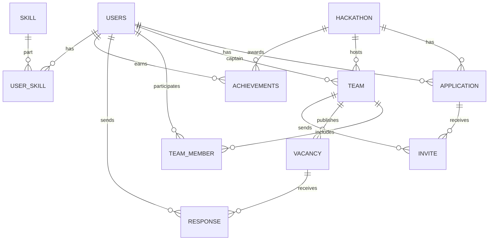

# TeamFinder Backend (FastAPI)

Бэкенд для Telegram Mini App, которая помогает участникам хакатона находить команды/участников: создавать команды, публиковать вакансии, откликаться на вакансии, приглашать по анкетам и фиксировать достижения.

> Важно для запуска локально: в приложении включён `root_path="/api"` (ориентировано на деплой за reverse-proxy). Если вы поднимаете сервис **без** прокси, запросы делайте по «сырому» пути (например, `/system/health`).

---

## Технологии

- Python **3.12**
- **FastAPI** (ASGI)
- **SQLAlchemy 2.x (asyncio)** + **asyncpg**
- **Pydantic v2** + **pydantic-settings**
- JWT (HS256) — минимальная реализация в `utils/jwt_simple.py`
- Авторизация через **Telegram WebApp init_data** (проверка подписи в `utils/telegram_initdata.py`)
- S3‑совместимое хранилище (Yandex Cloud / MinIO / AWS S3) для картинок хакатонов — `aioboto3`
- Dockerfile для контейнерного запуска

---

## Архитектура бэкенда

Архитектура — слоистая (HTTP → сервисы → репозитории → ORM):

```mermaid
graph TD
    A[HTTP запрос] --> B[FastAPI routers (presentations/routers)]
    B --> C[Services (services/*)]
    C --> D[Repositories (repositories/*)]
    D --> E[ORM models (persistend/models)]
    E --> F[(PostgreSQL)]

    B --> G[Auth: JWT + Telegram init_data]
    B --> H[Admin auth: X-Admin-Token]
```

### Что где лежит

```
backend/
  main.py                    # точка входа (uvicorn)
  presentations/
    app.py                   # create_app(), middlewares, подключение роутеров
    routers/                 # HTTP-слой: эндпоинты + Pydantic-схемы
  services/                  # бизнес-логика/оркестрация (hackathons, teams, invites...)
  repositories/              # доступ к данным (SQLAlchemy async)
  persistend/                # ORM-модели и enum'ы (название папки историческое)
  infrastructure/            # db engine/session, S3, Telegram files, admin auth
  settings/                  # конфигурация (pydantic-settings)
  utils/                     # JWT и Telegram init_data
```

### Принципы

- **Async-first**: все операции I/O (Postgres, Telegram, S3) асинхронные.
- **Короткоживущие сессии**: репозитории открывают `AsyncSession` «на операцию» через `async_sessionmaker`.
- **Разделение ответственности**:
  - роутеры — HTTP, схемы, права доступа;
  - сервисы — оркестрация нескольких репозиториев/инфраструктуры;
  - репозитории — SQL и маппинг ORM.

---

## Доменная модель

Ключевые сущности:

- **User** — пользователь Telegram
- **Skill** + `user_skill` — навыки (many-to-many)
- **Hackathon** — хакатон
- **Application** — анкета пользователя на конкретный хакатон (1 анкета на пользователя в рамках хакатона)
- **Team** + **TeamMember** — команда и участники
- **Vacancy** — вакансия команды (роль, описание)
- **Response** — отклик пользователя на вакансию
- **Invite** — приглашение от команды к анкете
- **Achievement** — достижения на хакатонах



### Инварианты (как реализованы)

- **Одна анкета на хакатон для пользователя**: `UniqueConstraint(hackathon_id, user_id)` в модели `Application`.
- **Участник уникален в команде**: `(team_id, user_id)` — составной PK в `TeamMember`.
- **Ограничение «одна команда на хакатон для пользователя»**: проверяется на уровне роутера/сервиса (перед accept invite/response).
- **Принятие инвайта** сделано атомарно через SQL‑функцию в БД `accept_invite(invite_id, actor_user_id)` (см. `services/invites.py`).
- **Принятие отклика (Response)** сейчас делается в роутере и включает несколько шагов: добавление участника, закрытие вакансии, скрытие анкеты, «протухание» других откликов. Это можно улучшить оборачиванием в транзакцию.

---

## Авторизация

### Пользовательская авторизация (Telegram → JWT)

- `POST /auth/telegram` — принимает `init_data` от Telegram Mini App, проверяет подпись, делает upsert пользователя, возвращает JWT.
- `POST /auth/dev-login` — dev‑логин без Telegram (только если `APP_ENV != prod`).

JWT кладётся в заголовок:

```
Authorization: Bearer <token>
```

`sub` в токене содержит `user_id`.

### Админ‑доступ

Часть ручек (управление хакатонами) защищена заголовком:

```
X-Admin-Token: <ADMIN_API_TOKEN>
```

Проверка — `infrastructure/admin_auth.py`.

---

## Конфигурация (.env)

Настройки читаются через `pydantic-settings` из переменных окружения и файла `.env`.

Минимально необходимые для старта:

- Postgres:
  - `POSTGRES_HOST`, `POSTGRES_PORT`, `POSTGRES_DB`, `POSTGRES_USER`, `POSTGRES_PASSWORD` *(или `DATABASE_URL`)*
- Auth:
  - `TELEGRAM_BOT_TOKEN`
  - `JWT_SECRET`
  - `ADMIN_API_TOKEN` *(если нужны админ‑ручки)*
- Telegram deep-link (для join‑link команды):
  - `TG_BOT_USERNAME` (например, `teamfinder_test_bot`)
  - `TG_APP_NAME` (например, `tfapp`)
- S3 (нужно для загрузки обложек хакатонов):
  - `S3_BUCKET`, `S3_ACCESS_KEY`, `S3_SECRET_KEY`, `S3_PUBLIC_BASE_URL` *(и при необходимости `S3_ENDPOINT`)*

Пример `.env`:

```dotenv
APP_ENV=dev
JWT_SECRET=dev-secret-change-me

POSTGRES_HOST=localhost
POSTGRES_PORT=5432
POSTGRES_DB=app_db
POSTGRES_USER=app_user
POSTGRES_PASSWORD=app_password

TELEGRAM_BOT_TOKEN=123456:ABCDEF...
ADMIN_API_TOKEN=super-admin-token

TG_BOT_USERNAME=teamfinder_test_bot
TG_APP_NAME=tfapp

S3_ENDPOINT=https://storage.yandexcloud.net
S3_BUCKET=teamfinder
S3_ACCESS_KEY=...
S3_SECRET_KEY=...
S3_PUBLIC_BASE_URL=https://storage.yandexcloud.net/teamfinder
```

---

## Запуск

### 1) Локально (venv)

```bash
python -m venv .venv
source .venv/bin/activate
pip install -r requirements.txt

# выставить переменные окружения / создать .env
uvicorn main:app --reload --host 0.0.0.0 --port 8000
```

Проверка:

- `GET /system/health`

### 2) Docker

```bash
docker build -t teamfinder-backend .
docker run --rm -p 8000:8000 --env-file .env teamfinder-backend
```

PostgreSQL поднимается отдельно (локально или отдельным контейнером).


### Инициализация схемы БД (dev)

В репозитории нет Alembic‑миграций. Для локального dev можно создать таблицы через `Base.metadata.create_all()`.

Особенность: в модели `Achievement` тип enum `achiev_place` помечен как `create_type=False`, поэтому **его нужно создать заранее**:

```sql
CREATE TYPE achiev_place AS ENUM ('firstPlace','secondPlace','thirdPlace','finalyst','participant');
```

Далее можно создать таблицы:

```bash
python -c "import asyncio; from infrastructure.db import engine; from persistend.base import Base;

async def main():
    async with engine.begin() as conn:
        await conn.run_sync(Base.metadata.create_all)

asyncio.run(main())"
```


## Swagger / OpenAPI

- Swagger UI: `/docs`
- OpenAPI JSON: `/openapi.json`

В проде сервис обычно проксируется под префиксом `/api`. В коде это отражено через `root_path="/api"`.
Если вы запускаете backend напрямую **без** прокси и в Swagger видите ошибку загрузки схемы (попытка получить `/api/openapi.json`),
временно измените `root_path` в `presentations/app.py` (например, на пустую строку) или поднимайте сервис за прокси, который отрезает префикс `/api`.

---

## Основные ручки API (high-level)

Полный список и схемы — в OpenAPI/Swagger.

- Auth: `POST /auth/telegram`, `POST /auth/dev-login`
- Users: `GET /users/me`, `PATCH /users/me`, `GET /users` (поиск)
- Skills: `GET /skills`
- Hackathons: `GET /hackathons`, `GET /hackathons/{id}`
- Applications: `POST /hackathons/{hackathon_id}/applications/me`, `GET /me/applications`
- Teams: создание/редактирование команды, управление участниками, join‑link
- Vacancies: вакансии команды + список вакансий по хакатону
- Responses: отклики на вакансии + принятие/отклонение капитаном
- Invites: инвайты к анкетам + принятие/отклонение владельцем анкеты
- Achievements: создание/листинг в `users.py`, update/delete в `achievements.py`

---

## Примечания по текущему состоянию (для защиты проекта)

- Миграции Alembic в этом репозитории отсутствуют: предполагается, что схема БД разворачивается отдельно.
- `persistend/enums.py` содержит повторяющиеся определения некоторых enum'ов (в Python используется последняя декларация).
- В нескольких местах есть технический долг (например, принятие `Response` не завернуто в транзакцию).

Эти пункты можно использовать как аргументы для «что бы улучшили дальше» на защите.